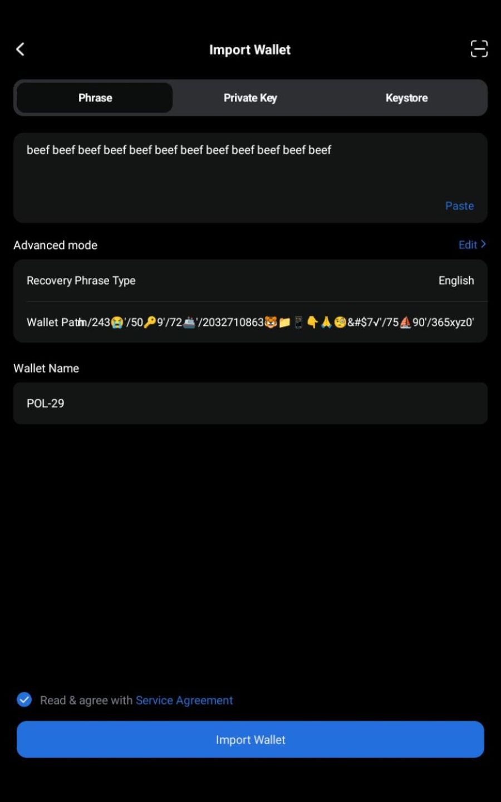
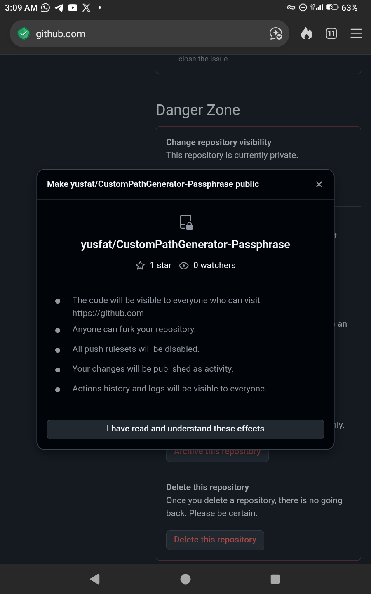
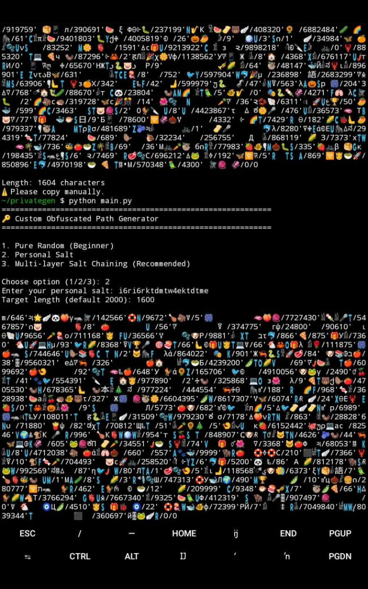

# CustomPathGenerator-Passphrase

**High-entropy custom path & passphrase generator**

> Assume breach. Verify recovery. Never trust a single factor.

**At least 200 levels deep · Non-standard · Advanced users only**

## Preview

---
## Important security distinction

A **derivation path** tells a wallet which child keys to derive from a seed. Standard paths consist of numeric components and wallet-specific conventions.

A **BIP-39 passphrase** is a separate input used with a BIP-39 mnemonic to derive a wallet seed. It is not the same thing as a derivation path. Losing or mistyping a passphrase can make the associated wallet inaccessible.

Some wallet interfaces may accept a path string containing extra characters and ignore or remove those characters when parsing its numeric components. In that case, the noisy string and cleaned numeric path can produce the same wallet.

That equivalence may be useful for **wallet-specific formatting or obfuscation**. However:

- Characters ignored by a wallet do not change the derived keys.
- Ignored characters do not add cryptographic entropy or strengthen the wallet.
- Another wallet or software version may reject or interpret the string differently.
- A noisy path is not a substitute for a strong, securely generated seed or a carefully managed BIP-39 passphrase.

Do not assume behavior is portable. Verify it with the exact wallet, version, and interface you plan to use (these emojis etc. noise were accepted and tested as both derivation paths and also as passphrase on Tokenpocket and AirgapVault.io .

---

## Security & Non-determinism (important)

Do note that this generator is *intentionally non-deterministic* all through.

Even if you input the identical personal salt (Option 2) or the identical salt-chain layers (Option 3), you will *never* receive the same path twice. This is intentional and is a security feature, not a bug.

### What this means for you
- You *cannot* recreate a previous path by entering your personal salt again.
- The *only* method to recover the wallet is to have saved the final output that was printed.
- A weak personal salt remains safe because it is always combined with a strong, unique system salt plus additional randomness.
- Even if an attacker obtains only your personal salt, he still cannot reproduce the path.
- PLEASE do further refer to SECURITY.md file

---

## Why this exists

Seed phrases alone are no longer enough.

**February 2025, Bybit (~$1.5B):** A compromised UI led signers to approve what they *saw*, not what they *signed*. The seed was not the only failure mode.

**February 2025, Bybit, about 1.5 billion dollars:** The signers approved what they saw on screen, not what they actually signed. The UI for the Safe multisig was compromised. The transaction looked like a routine transfer, but the payload was changed to take over the cold wallet contract. One bad approval drained about 400k ETH and stETH variants in minutes. The seed was fine, the devices were fine, but blind signing on a compromised front end bypassed all of it. This is why clear signing and offline verification of what is being signed matters, not just how the seed was made.

This tool is built to show and recommend an integrated approach: multisig co-signers, airgapped cold wallets, and advanced passphrase with high entropy custom derivation paths, as well as intentionally slowing down brute force and making (noise) patterns highly unpredictable.

**2026 Coldcard weak-RNG reports:** Trusted hardware can still create weak seeds. If entropy was weak at generation, safe storage does not help. A firmware bug from 2021 made Coldcard fall back to a weak software RNG giving about 40 bits on Mk2 and Mk3 and about 72 bits on Mk4 and Q instead of using the hardware RNG. That led to three to four attack waves starting July 30 2026 that drained around 1789 BTC or about 114 million dollars from around 8865 addresses. All seeds made without extra entropy on Mk2, Mk3, Mk4, Q and Mk5 were at risk, while seeds made with 50 or more private dice rolls were safe.

This is why offline verifiable entropy like this custom path generator matters. You can prove entropy at generation time and not trust a closed check, even when a seed had been exposed without knowing.

**9-10th Oct, 2026:** Also motivated by the October 9-10th, 2026 $86M Ledger supply-chain incident where reseller-implanted devices exfiltrated recovery phrases, this project/tool provides a fully transparent, offline and verifiable method for private key (custom path / passphrase) generation where nothing ever leaves your device.

**Lesson:** Even when you do many things right, the seed can be exposed, weak or compromised via supply-chain attack. A second, independent, high-entropy factor such as noise obfuscation like this tool, reduces a single-point failure.

This tool generates that offline factor: a long, high-entropy string for use as a **BIP39 passphrase** and/or an experimental **custom derivation path**, on top of a standard seed you already protect properly (even though we shall assume it's somehow, unknowingly exposed, to be on a safer side while recognizing the security implications and recoverability factors of using this tool without understanding the risk(s).

This project aims to introduce **entropy noise** in a way that already-tested crypto wallets do not treat as an “invalid index” - notably **TokenPocket** and **AirGap Vault** - so a noisy path string can still resolve for those stacks when their parsers effectively use the numeric index portions.

### Origin discovery (core of this project)

In **October 2024**, I carried out a small manual test using emojis, non-ASCII characters, and other noise inside path segments. Example:

**Custom path with noise:**

    m/243😭'/50🔑9'/72🐱'/2032710863🦊💼👇🙏😳&#$7'/75🪑90'/365xyz0'

**Cleaned path (digits / hardening only):**

    m/243'/50'/72'/2032710863'/75'/365'

Both produced the **same** wallet address after that experiment:

    0x5673170D4cBd2Ca8b186900EE731d38E84E7e5C8

Tweaking alphabets, characters, and digits around that idea led to this project: **noise for human / storage entropy**, while remaining usable in wallets that already accepted such paths in testing - not a claim that every wallet worldwide behaves the same.

---

## What it is (and is not)

| It is | It is not |
| :--- | :--- |
| An offline entropy tool for advanced users | A wallet, exchange, or custodian |
| A generator of long high-entropy strings | Guaranteed BIP32 support in every app |
| Useful as a BIP39 passphrase (25th word) | Audited financial software |
| Local Python (no network for core generation) | Protection against phishing or blind signing |
| Built around tested noisy-path behavior on selected wallets | A guarantee that noise is ignored on all firmware/apps |
| A TOOL YOU CAN USE AS EITHER A CUSTOM PATH OR A PASSPHRASE, OR BOTH (if you must choose one, use it as Passphrase (stronger cryptographic security and protection of your crypto wallet))| IT IS NOT A STANDARD OR COMMON PATH COMPATIBLE WITH MOST WALLETS|
| A tool that is compatible with safepal wallet (passphrase only but maximum of 128 characters (meaning you must modify the target_length of this generator (config.py file)), TokenPocket and AirgapVault wallet (Best options - both as passphrase and custom derivation path) etc.| IT IS NOT COMPATIBLE WITH MOST WALLETS such as MetaMask, Trust Wallet etc. which do not have advanced features like passphrase|

**Recommended use order**

1. BIP39 passphrase (widest compatibility)
2. Custom path only where the wallet truly accepts it
3. Separate path + separate passphrase for stronger separation
4. Same string for both only if you accept less separation
5. TWO DIFFERENT CUSTOM PATHS: ONE AS CUSTOM PATH, THE OTHER FOR PASSPHRASE (MOST RECOMMENDED BUT REQUIRES MORE PROPER STORAGE. NB: YOU CAN USE THIS GENERATOR OUTPUT EVEN FOR BITWARDEN MASTER PASSWORD 🔑 , *Facebook Password* etc. JUST LIKE THE AUTHOR DOES - WITH IT STORED IN A SECOND BITWARDEN ACCOUNT WITHOUT COMPLEX PASSWORD FOR EASY ACCESS AND AVOIDING SELF LOCK-OUT 🔒 🔐)

**If you lose the factor(s), funds can be gone forever.**

---

## How it works

### Path construction

1. Input string → **SHA3-512** → key bytes
2. About **220–299** segments under `m/`
3. Early levels prefer hardened indices (`'`); later levels often hardened (~75%)
4. **HMAC-SHA3-512** drives index digits and noise
5. Noise from invisibles, spaces, emoji/symbols, multi-script characters, non-ASCII letters, ASCII (excluding `/ \ " '`)
6. Minimum length **2000** characters; trim/ending as implemented in code

Noise is placed so paths stay in the spirit of the October 2024 finding: rich entropy in the **string you store**, while numeric index structure remains the part many tested UIs effectively care about. **Always verify on your device**; do not assume every app strips noise the same way.

### Salts (main.py)

| Mode | Behavior |
| :--- | :--- |
| Beginner / pure random | Fresh **system salt** only |
| Personal salt | Your salt (≥50 chars) + fresh system salt |
| Salt chaining | Multiple layers (SHA3-512 fold); optional hidden random layers + system salt |

**System salt:** random bytes → **PBKDF2-HMAC-SHA3-512** (high iteration count) → hex mixed into the generator input. **Not printed.**

**Critical recovery rule:** Because system salt is new every run, **re-typing only a personal salt will not recreate the same path**. Always save the **final printed output** (and any separate passphrase).

### Interactive inputs (what the tool asks)

When you run main.py, you are guided through:

- **User mode:** Beginner (b) or Advanced (a)
- **Desired path length:** minimum **2000** characters
- **Optional personal salt or multi-layer salt chaining:** Advanced mode only

### Optional separate passphrase

High-entropy string for use as an extra factor (e.g. BIP39 passphrase), stored and labeled separately from the path output.

---

## Risk model

| Risk | Without a second factor | With this factor (if the wallet uses it) |
| :--- | :--- | :--- |
| Seed exposed | Seed alone moves funds | Attacker still needs your saved path/passphrase |
| Weak RNG at seed generation | Vendor trust only | External high-entropy factor raises attack cost |
| Blind / malicious signing | See ≠ sign | Does **not** replace verifying transactions |
| Self-lockout | — | Mandatory small-amount recovery test before real funds |

**Suggested practice:** dedicated or air-gapped machine when stakes are high; multisig so one exotic factor cannot brick the whole vault; seed offline; path/passphrase in a password manager **never** stored with the seed.

---

## Safety protocol

1. Generate offline
2. Test wallet with seed + saved factor(s)
3. Send a trivial amount only
4. Wipe / remove wallet data
5. Recover using **only** what you stored (check full **length**; Unicode can drop in bad copy/paste)
6. Fund more only after recovery works

---

## Wallet notes (author-tested)

| Wallet | Role |
| :--- | :--- |
| AirGap Vault | Custom path + passphrase (noisy-path behavior aligned with project origin tests) |
| TokenPocket | Custom path + passphrase (noisy-path behavior aligned with project origin tests) |
| BlueWallet * | Passphrase only |
| Electrum * | Passphrase only |

* Another name for Passphrase in most/other wallets is Advanced Mode

The October 2024 manual sample (noisy vs cleaned path → same address 0x5673170D4cBd2Ca8b186900EE731d38E84E7e5C8) informed the design goal: entropy noise without an immediate “invalid index” failure on those stacks. **Re-check on your device and version.** Support and parsing can change.

---

## Project layout

    main.py
    custompath/
      __init__.py
      config.py
      crypto.py
      generator.py
      pools.py
    README.md
    LICENSE
    SECURITY.md
    
---
## Contributing

Please include reproducible tests for code changes and exact wallet/version details for compatibility claims. Do not include real recovery phrases, private keys, passphrases, or funded-wallet data in issues or pull requests.

NB: IF YOU FIND THIS TOOL REALLY HELPFUL, YOU MAY TIP THE AUTHOR...
BTC Address: 377GSHdGNZtxxvcu8SvoYurqeCoJWCgzre

---

## Requirements

- **Python 3.12+** recommended (3.10+ may work)
- **Standard library only** for core generation
- Optional: **Termux** with termux-clipboard-set for clipboard copy

---

## How to run

    git clone https://github.com/yusfat/CustomPathGenerator-Passphrase.git
    cd CustomPathGenerator-Passphrase
    python3 -m venv .venv
    source .venv/bin/activate
    python3 main.py               # python main.py also works, always 

or, if you do not want to use a virtual environment:

    git clone https://github.com/yusfat/CustomPathGenerator-Passphrase.git
    cd CustomPathGenerator-Passphrase
    python3 main.py

You can replace or rename folder 📁 name CustomPathGenerator-Passphrase to any name of your choice. A short pause during system-salt PBKDF2 is normal (as that was intentionally designed to slow down offline attacker). A pause during system-salt processing may be expected. Check the source code and dependencies before using the program with sensitive material.

NB: A normal short level standard path (and an app version) would be released soon...

---

## What you will be asked

1. Beginner (b) or Advanced (a)
2. Target length (minimum **2000**)
3. If Advanced: pure random / personal salt / salt chaining
4. Optional separate passphrase (y/n)
5. Generate another? (y/n)

---

## After generation

- Copy the **DERIVATION PATH** (and passphrase if you made one)
- Store **only finals** in Bitwarden / KeePass / 1Password
- Label clearly; **never** store with the seed
- Verify **character length** after saving
- Test recovery with a trivial amount before real funds

---

## Warnings

1. **Irrecoverable if lost**
2. **Invisibles can vanish** in bad copy/paste - check length
3. **Many wallets reject long custom paths** - prefer passphrase unless tested
4. **Not audited**
5. **System salt is not shown and changes every run** - back up the printed final string
6. **Noisy-path equivalence is wallet-specific** - confirmed in author tests on selected apps; never assume universal BIP32 behavior

---

## License

MIT. See the LICENSE file in this repository.

---

## Disclaimer

This software is provided **as-is**, without warranty. Digital asset loss can be permanent. Authors and contributors are not liable for lost funds, wallet incompatibility, or misuse.

**Test recovery with a trivial amount before any real value.**

---

*Protect your sovereignty. Assume breach. Verify recovery.*

